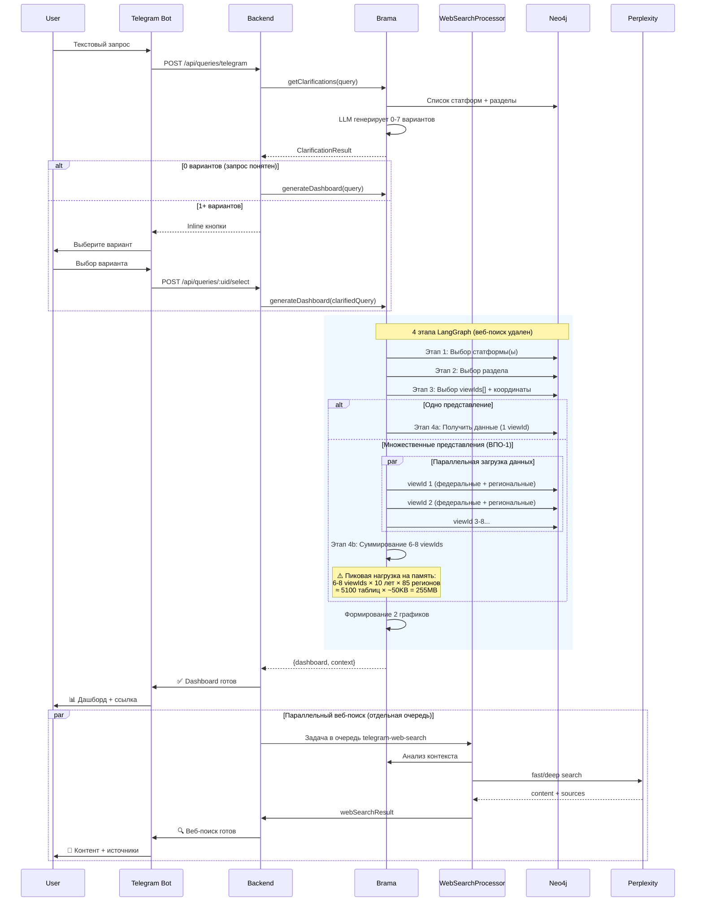
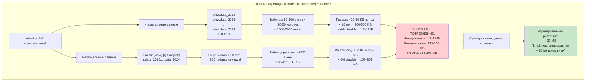
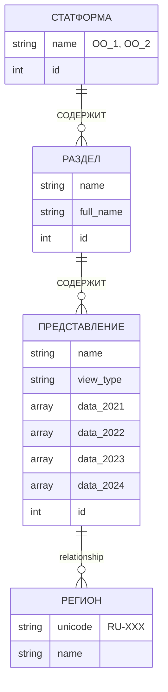

# Архитектура Brama

> **Версия:** 5.0
> **Дата:** 2025-12-02
> **Статус:** ✅ Production

---

## Краткое резюме

**Brama** — сервис обработки запросов на естественном языке для генерации аналитических дашбордов на основе данных из Neo4j.

### Ключевые возможности

- **Уточнение запроса**: LLM генерирует 0-7 вариантов уточнения, пользователь выбирает нужный
- **LangGraph workflow**: 4 последовательных этапа анализа запроса (было 5)
- **Параллельный веб-поиск**: Perplexity API выполняется в отдельной очереди после основного workflow
- **Множественный выбор представлений**: LLM анализирует несколько viewIds и суммирует данные
- **Агрегация данных**: Поддержка суммирования 6-8 представлений формы ВПО-1
- **Graceful degradation**: Система работает даже если веб-поиск недоступен

### Этапы обработки

```
Уточнение запроса (0-7 вариантов) → Пользователь выбирает
  ↓
1. selectStatform    → выбор статформы(ы)
2. selectSection     → выбор раздела
3. selectViewCells   → выбор viewIds[] + координаты (множественный выбор)
4. generateDashboard → суммирование данных + формирование графиков
  ↓
Dashboard (2 графика) отправляется в Backend
  ↓
Backend запускает WebSearchProcessor (параллельно, отдельная очередь)
  ↓
WebSearch результат (отдельное сообщение в Telegram)
```

---

## Основные компоненты

### 1. DashboardGenerator
**Роль:** Точка входа и оркестратор

```typescript
class DashboardGenerator {
  static async initialize(): Promise<void>
  static async getClarifications(question: string): Promise<ClarificationResult>
  static async generateDashboardWithWebSearch(question: string): Promise<QueryProcessResult>
}
```

### 2. QueryAgent (LangGraph)
**Роль:** Анализ запроса через 5 этапов

```typescript
class QueryAgent {
  async clarifyQuery(query: string): Promise<ClarificationResult>
  async processQueryWithWebSearch(query: string): Promise<QueryProcessResult>
}
```

**Результат:**
```typescript
interface QueryProcessResult {
  dashboard: DashboardData;           // Всегда есть
  webSearchResult?: WebSearchResult;  // Опционально
}
```

### 3. DashboardService
**Роль:** Генерация финального dashboard с графиками

```typescript
async generateDashboard(input: {
  viewId: number;
  colIndex: number;
  rowIndex: number;
  metadata: { viewName, sectionName, statformName };
}): Promise<DashboardData>
```

### 4. Shared Modules

**LLMClient** — DeepSeek через AITunnel
```typescript
chat(systemPrompt: string, userMessage: string): Promise<string>
chatJSON<T>(systemPrompt, userMessage, schema: z.ZodType<T>): Promise<T>
```

**Neo4jClient** — граф образовательной статистики
```typescript
getAvailableYears(viewId: number): Promise<number[]>
getFederalData(viewId: number, years: number[]): Promise<Record<string, any[][]>>
getRegionalData(viewId: number, years: number[]): Promise<RegionalDataRow[]>
```

**PerplexityClient** — веб-поиск
```typescript
fastSearch(query: string): Promise<PerplexityResponse>    // sonar
deepResearch(query: string): Promise<PerplexityResponse>  // sonar-deep-research
```

---

## LangGraph Workflow

### QueryState (AgentState)

```typescript
interface AgentState {
  // Входные данные
  query: string;  // Оригинальный запрос пользователя

  // Результат уточнения (Этап 0)
  clarification?: ClarificationResult;

  // Результаты этапов
  statformSelection?: {
    statformIds: number[];  // 1-2 статформы
    reasoning?: string;
  };

  sectionSelection?: {
    sectionId: number;
    sectionName: string;
    reasoning?: string;
  };

  viewSelection?: {
    viewIds: number[];  // НОВОЕ: Массив представлений (было одно viewId)
    cellCoordinates: {
      colIndex: number;
      rowIndex: number;
      columnName?: string;
      rowName?: string;
    };
    similarCellCoordinate?: CellCoordinates;  // ВРЕМЕННО: для объединения
    metadata: {
      viewNames: string[];  // НОВОЕ: Массив названий
      sectionName: string;
      statformName: string;
    };
    reasoning?: string;
  };

  // Веб-поиск УДАЛЕН из LangGraph workflow
  // (теперь выполняется в отдельном процессоре)

  // Финальный результат
  dashboardData?: DashboardData;

  // Ошибки
  error?: string;
}
```

### Этап 0: Уточнение запроса (опционально)

**Цель:** Предложить пользователю 0-7 конкретных вариантов на основе данных в Neo4j

**Процесс:**
1. Получить список всех статформ и разделов из Neo4j
2. LLM анализирует запрос и определяет уровень неопределенности:
   - **0 вариантов** → запрос полностью понятен, уточнение не требуется
   - **4-7 вариантов** → в зависимости от уровня неопределенности
3. Если 0 вариантов → возврат пустого массива + reasoning
4. Если >0 вариантов → возврат пользователю для выбора
5. После выбора — продолжение основного workflow

**Специальные случаи:**
- **Региональные запросы:** Генерируется `warning` о доступности данных в дашборде
- **Несуществующие данные:** Предлагаются близкие варианты + `warning`
- **Множественная интерпретация:** "обучающиеся" → 4 варианта (школьники, вузы, СПО, ДПО)

**Примеры:**
```
Запрос: "студенты государственных вузов"
→ 0 вариантов (запрос однозначен)
→ Пользователь видит: "✅ Перехожу к поиску..."
→ Workflow продолжается сразу с Этапа 1

Запрос: "школьники в Московской области"
→ 4 варианта:
  1. Общее количество школьников по годам
  2. Распределение по классам обучения (1-11)
  3. Школьники в городских и сельских школах
  4. Школьники с ограниченными возможностями здоровья
→ Warning: "Данные по конкретным регионам доступны в дашборде при наведении на регион"
→ Пользователь выбирает → продолжение
```

### Этап 1: Выбор статформы

**Цель:** Определить релевантную статистическую форму (ОО_1, ОО_2, ...)

**Процесс:**
1. Получить список всех статформ из Neo4j
2. LLM выбирает 1-2 релевантные статформы
3. Сохранить `statformIds[]` в State

### Этап 2: Выбор раздела

**Цель:** Выбрать конкретный раздел внутри статформы

**Процесс:**
1. Получить все разделы для выбранных статформ
2. LLM выбирает наиболее подходящий раздел
3. Сохранить `sectionId` в State

### Этап 3: Выбор представлений и ячейки

**Цель:** Найти одно или несколько представлений (viewIds[]) с конкретными координатами ячейки

**Особенности (ИЗМЕНЕНО в v5.0):**
- **Множественный выбор представлений**: LLM может выбрать несколько viewIds для агрегации
- **Единые координаты**: Для всех viewIds используются одинаковые colIndex/rowIndex
- **Поиск похожих ячеек**: ВРЕМЕННО поддерживается similarCellCoordinate

**Процесс:**
1. Получить список представлений (views) для раздела
2. Для каждого представления получить схему таблицы
3. LLM анализирует и выбирает:
   - `viewIds: number[]` (может быть 1 или более)
   - `cellCoordinates: {colIndex, rowIndex}`
   - `metadata: {viewNames[], sectionName, statformName}`
4. Сохранить в State

**Примеры множественного выбора:**
- Форма ВПО-1: 6-8 представлений с данными по разным программам → суммирование
- Форма СПО: несколько представлений с разными уровнями образования → агрегация

### Этап 4: Генерация dashboard (с агрегацией)

**Цель:** Создать финальный dashboard с двумя графиками, суммируя данные из нескольких представлений

**Процесс (ИЗМЕНЕНО в v5.0):**

**Режим 1: Одно представление (viewIds.length === 1)**
1. Получить доступные годы для viewId
2. Извлечь федеральные данные (view.data_YYYY)
3. Извлечь региональные данные (relationships)
4. Сформировать 2 графика
5. Сохранить `dashboardData` в State

**Режим 2: Множественные представления (viewIds.length > 1)**
1. Для каждого viewId получить доступные годы
2. Найти **пересечение годов** (только общие для всех viewIds)
3. **Параллельно** извлечь федеральные данные из всех viewIds
4. **Суммировать** федеральные данные (CellExtractor.sumFederalDataMultiView)
5. **Параллельно** извлечь региональные данные из всех viewIds
6. **Суммировать** региональные данные (CellExtractor.sumRegionalDataMultiView)
7. Сформировать 2 графика с агрегированными данными
8. Сохранить `dashboardData` в State

**⚠️ Критическое место для оптимизации памяти:**
- При работе с формой ВПО-1 может потребоваться загрузка 6-8 viewIds × 10 лет × 85 регионов = **до 5100 таблиц**
- Подробный анализ памяти см. раздел "Анализ потребления оперативной памяти"

### Веб-поиск (вынесен из LangGraph workflow)

**Изменение архитектуры (v5.0):**
- Веб-поиск **УДАЛЕН** из основного LangGraph workflow
- Теперь выполняется **параллельно** в отдельном процессоре

**Новая схема:**
1. LangGraph завершает работу и возвращает dashboard + context
2. Backend получает dashboard и сохраняет его
3. Backend отправляет dashboard в Telegram
4. Backend **параллельно** ставит задачу в очередь `telegram-web-search`
5. WebSearchProcessor обрабатывает веб-поиск
6. Результат отправляется отдельным сообщением в Telegram

**Преимущества:**
- ✅ Пользователь получает dashboard быстрее (не ждет веб-поиска)
- ✅ Ошибки веб-поиска не блокируют основной workflow
- ✅ Независимое масштабирование (concurrency=5 для веб-поиска)
- ✅ Graceful degradation по умолчанию

---

## Диаграммы

### Sequence Diagram (v5.0)



### State Flow (v5.0)

```mermaid
graph TD
    Start([START]) --> Clarify[Этап 0: clarifyQuery<br/>0-7 вариантов]
    Clarify --> UserChoice{0 вариантов?}

    UserChoice -->|Да| S1[Этап 1: selectStatform]
    UserChoice -->|Нет| Wait[Ожидание выбора<br/>пользователя]
    Wait --> S1

    S1 --> S2[Этап 2: selectSection]
    S2 --> S3[Этап 3: selectViewCells<br/>viewIds[] + координаты]
    S3 --> CheckMulti{viewIds.length > 1?}

    CheckMulti -->|Нет| S4a[Этап 4a: generateDashboard<br/>Одно представление]
    CheckMulti -->|Да| S4b[Этап 4b: generateDashboard<br/>Агрегация 6-8 представлений<br/>⚠️ Пиковая память]

    S4a --> End([END<br/>dashboard + context])
    S4b --> End

    End --> BackendQueue[Backend: очередь<br/>telegram-web-search]
    BackendQueue --> WebSearch[WebSearchProcessor<br/>Параллельно]

    style Clarify fill:#FFE0B2
    style S1 fill:#E3F2FD
    style S2 fill:#E8F5E9
    style S3 fill:#FFF3E0
    style S4b fill:#FFCDD2
    style WebSearch fill:#F3E5F5
```

### Структура модулей

```
brama/src/
├── utils/
│   └── dashboardGenerator.ts       # Точка входа
├── query-agent/                    # LangGraph workflow
│   ├── index.ts                    # QueryAgent
│   ├── graph/
│   │   ├── graph.ts                # Определение графа
│   │   ├── state.ts                # QueryState
│   │   └── nodes/
│   │       ├── selectStatformNode.ts
│   │       ├── selectSectionNode.ts
│   │       ├── selectViewCellsNode.ts
│   │       ├── perplexityWebSearchNode.ts
│   │       └── generateDashboardNode.ts
│   ├── prompts/                    # LLM промпты
│   │   ├── queryClarification.ts
│   │   ├── statformSelection.ts
│   │   ├── sectionSelection.ts
│   │   ├── viewCellSelection.ts
│   │   └── webSearchDecision.ts
│   └── modules/                    # Вспомогательные функции
├── dashboard-service/              # Генерация графиков
│   ├── dashboardGenerator.ts
│   ├── cellExtractor.ts
│   └── chartFormatters/
│       ├── linearChart.ts
│       └── russiaMapChart.ts
└── shared/                         # Общие клиенты
    ├── llmClient.ts                # DeepSeek
    ├── neo4jClient.ts              # Neo4j
    ├── perplexityClient.ts         # Perplexity API
    └── logger.ts
```

---

## Контракты API

### DashboardGenerator.getClarifications()

```typescript
getClarifications(question: string): Promise<ClarificationResult>

interface ClarificationResult {
  suggestions: Array<{
    id: number;
    label: string;           // "Общее количество"
    description: string;     // "Общее количество школьников..."
  }>;                        // 0-7 вариантов (было: 4-7)
  reasoning?: string;
  warning?: string;          // НОВОЕ: предупреждение о региональных/несуществующих данных
}
```

### DashboardGenerator.generateDashboardWithWebSearch()

```typescript
generateDashboardWithWebSearch(question: string): Promise<QueryProcessResult>

interface QueryProcessResult {
  dashboard: DashboardData;
  webSearchResult?: WebSearchResult;
}

interface WebSearchResult {
  searchMode: 'fast' | 'deep';
  content: string;
  sources?: string[];
  query: string;
}
```

### DashboardData

```typescript
interface DashboardData {
  dashboard: {
    title: string;
    description: string;
    charts: [LinearChart, RussiaMapChart];  // Ровно 2 графика
  };
}
```

**LinearChart:**
```typescript
{
  type: 'linear',
  title: 'Федеральные данные по годам',
  data: {
    years: [{
      points: [
        { x: 2021, y: 17314160 },
        { x: 2022, y: 17745037 },
        { x: 2023, y: null },      // null если нет данных
        { x: 2024, y: 17988139 }
      ]
    }]
  }
}
```

**RussiaMapChart:**
```typescript
{
  type: 'russia_map',
  title: 'Интерактивная карта России',
  data: {
    years: [
      {
        year: 2021,
        regions: [
          { regionCode: 'RU-MOW', value: 5432 },
          { regionCode: 'RU-SPE', value: 3210 },
          { regionCode: 'RU-SVE', value: null }
        ]
      }
    ]
  }
}
```

### Callback формат

**С веб-поиском:**
```json
{
  "status": "completed",
  "result": {
    "dashboard": { "title": "...", "charts": [...] },
    "webSearchResult": {
      "searchMode": "fast",
      "content": "По данным Минпросвещения...",
      "sources": ["https://edu.gov.ru/..."],
      "query": "общая численность школьников 2025"
    }
  }
}
```

**Без веб-поиска:**
```json
{
  "status": "completed",
  "result": {
    "dashboard": { "title": "...", "charts": [...] }
  }
}
```

---

## Анализ потребления оперативной памяти

### Проблема: Пиковая нагрузка при агрегации ВПО-1

**Критический сценарий:**
- Форма ВПО-1 содержит 6-8 представлений (viewIds) с данными по разным программам
- Для каждого viewId нужно загрузить федеральные и региональные данные
- Данные за 10 лет × 85 регионов × 6-8 представлений = **до 5100 таблиц**

### Расчет потребления памяти



### Детальный расчет для формы ВПО-1 (максимальный сценарий)

#### Федеральные данные

```
Один viewId:
  - data_2015...data_2024 (10 лет)
  - Таблица: 80 строк × 40 колонок = 3200 ячеек
  - Размер ячейки: ~15 байт (число + overhead)
  - Размер таблицы: 3200 × 15 = 48 KB
  - За 10 лет: 48 KB × 10 = 480 KB

8 viewIds:
  - 480 KB × 8 = 3.84 MB
```

#### Региональные данные (КРИТИЧЕСКОЕ МЕСТО)

```
Один viewId, один регион, один год:
  - Таблица: 80 строк × 40 колонок = 3200 ячеек
  - Размер: 3200 × 15 = 48 KB

Один viewId, все регионы, один год:
  - 85 регионов × 48 KB = 4.08 MB

Один viewId, все регионы, 10 лет:
  - 4.08 MB × 10 = 40.8 MB

8 viewIds:
  - 40.8 MB × 8 = 326.4 MB ⚠️
```

#### ИТОГО (худший случай):

```
Федеральные:    3.84 MB
Региональные: 326.40 MB
─────────────────────────
ПИКОВАЯ ПАМЯТЬ: 330.24 MB

+ Overhead Node.js (V8 heap, LangGraph state): ~50-100 MB
+ Redis (Bull queue state): ~10-20 MB
+ Neo4j driver buffers: ~20-30 MB
─────────────────────────
РЕАЛЬНАЯ ПИКОВАЯ ПАМЯТЬ: ~410-480 MB на один запрос
```

### Текущее состояние: Параллельная загрузка

**Код:** `brama/src/dashboard-service/dashboardGenerator.ts:136-174`

```typescript
// STEP 3: Параллельно извлечь федеральные данные
const federalDataPromises = input.viewIds.map(async (viewId) => {
  const federalData = await neo4jClient.getFederalData(viewId, commonYears);
  return this.cellExtractor.extractFederalData(...);
});
const allFederalData = await Promise.all(federalDataPromises);

// STEP 6: Параллельно извлечь региональные данные
const regionalDataPromises = input.viewIds.map(async (viewId) => {
  const regionalData = await neo4jClient.getRegionalData(viewId, commonYears);
  return this.cellExtractor.extractRegionalData(...);
});
const allRegionalData = await Promise.all(regionalDataPromises);
```

**Проблема:**
- `Promise.all()` загружает **все 8 viewIds одновременно**
- Пиковое потребление памяти: **~480 MB**
- При `WORKER_CONCURRENCY=2` может достичь **~960 MB** (2 запроса × 480 MB)

### Рекомендации по оптимизации памяти

#### 1. Извлекать только нужные ячейки из региональных данных (ОПТИМАЛЬНОЕ РЕШЕНИЕ) ⭐

**Проблема:** Текущий метод `getRegionalData()` загружает **полные таблицы** для всех 85 регионов:

```cypher
-- ТЕКУЩИЙ КОД: Загружает ВСЕ ячейки всех таблиц
MATCH (view)-[r]->(region)
WHERE id(view) = $viewId
RETURN r.data_2015, r.data_2016, ..., r.data_2024
-- Каждая r.data_YYYY - это таблица 80×40 = 3200 ячеек
```

**Решение:** Извлекать **только одну ячейку** `[rowIndex][colIndex]` для каждого региона:

```typescript
// НОВЫЙ метод в neo4jClient.ts
async getRegionalCellData(
  viewId: number,
  years: number[],
  colIndex: number,
  rowIndex: number
): Promise<RegionCellData[]> {
  // Для каждого года извлекаем только нужную ячейку
  const yearQueries = years.map(year =>
    `r.data_${year}[${rowIndex}][${colIndex}] AS data_${year}`
  ).join(', ');

  const cypher = `
    MATCH (view)-[r]->(region)
    WHERE id(view) = $viewId
    RETURN
      region.unicode AS regionCode,
      region.name AS regionName,
      ${yearQueries}
  `;

  const result = await session.run(cypher, { viewId: neo4j.int(viewId) });

  return result.records.map(record => {
    const yearValues = new Map<number, number | null>();
    for (const year of years) {
      const value = record.get(`data_${year}`);
      yearValues.set(year, this.parseValue(value));
    }
    return {
      regionCode: record.get('regionCode'),
      regionName: record.get('regionName'),
      yearValues
    };
  });
}
```

**Использование в `dashboardGenerator.ts`:**

```typescript
// БЫЛО: загружать полные таблицы
const regionalData = await neo4jClient.getRegionalData(viewId, commonYears);
const extracted = this.cellExtractor.extractRegionalData(
  regionalData,
  input.colIndex,
  input.rowIndex,
  commonYears
);

// СТАЛО: загружать только нужные ячейки
const regionalCellData = await neo4jClient.getRegionalCellData(
  viewId,
  commonYears,
  input.colIndex,
  input.rowIndex
);
// Данные уже в нужном формате, парсинг не требуется
```

**Расчет экономии:**

```
БЫЛО (полные таблицы):
  85 регионов × 10 лет × (80 строк × 40 колонок) × 15 байт = 40.8 MB на viewId
  8 viewIds × 40.8 MB = 326 MB

СТАЛО (только нужные ячейки):
  85 регионов × 10 лет × 1 ячейка × 15 байт = 12.75 KB на viewId
  8 viewIds × 13 KB = 104 KB

ЭКОНОМИЯ: 326 MB → 104 KB = 99.97% 🚀
```

**Преимущества:**
- ✅ **Минимальная память**: 104 KB вместо 326 MB
- ✅ **Быстрее**: меньше данных передается из Neo4j
- ✅ **Проще**: не нужен CellExtractor для региональных данных
- ✅ **Работает с Promise.all**: можно оставить параллельную загрузку

#### 2. Последовательная загрузка viewIds + потоковая агрегация (ДОПОЛНЕНИЕ К #1)

**Идея:** Загружать viewIds последовательно и суммировать налету

```typescript
// Инициализация аккумулятора
const aggregatedFederal = new Map<number, number>();  // year -> sum
const aggregatedRegional = new Map<string, Map<number, number>>();  // regionCode -> year -> sum

// Загрузка и агрегация по одному viewId
for (const viewId of input.viewIds) {
  // Федеральные данные
  const federalData = await neo4jClient.getFederalData(viewId, commonYears);
  const extracted = this.cellExtractor.extractFederalData(
    federalData,
    input.colIndex,
    input.rowIndex,
    commonYears
  );

  // Сразу суммируем и удаляем из памяти
  for (const [year, cellValue] of extracted.dataByYear.entries()) {
    if (!cellValue.isNull) {
      aggregatedFederal.set(year, (aggregatedFederal.get(year) || 0) + cellValue.value);
    }
  }
  // extracted теперь может быть garbage collected

  // Региональные данные (с решением #1)
  const regionalCellData = await neo4jClient.getRegionalCellData(
    viewId,
    commonYears,
    input.colIndex,
    input.rowIndex
  );

  // Сразу агрегируем
  for (const regionData of regionalCellData) {
    if (!aggregatedRegional.has(regionData.regionCode)) {
      aggregatedRegional.set(regionData.regionCode, new Map());
    }
    const yearMap = aggregatedRegional.get(regionData.regionCode)!;

    for (const [year, value] of regionData.yearValues.entries()) {
      if (value !== null) {
        yearMap.set(year, (yearMap.get(year) || 0) + value);
      }
    }
  }
  // regionalCellData теперь может быть garbage collected
}
```

**Результат:**
- Пиковая память: ~500 KB (федеральные) + ~13 KB (региональные) + ~10 MB (аккумулятор) = **~11 MB**
- **Экономия: 480 MB → 11 MB = 97.7%**
- Недостаток: медленнее на ~3-5 секунд (последовательная загрузка)

#### 3. Постраничная загрузка регионов (АЛЬТЕРНАТИВА К #1)

**Если нельзя использовать прямой доступ к ячейке в Cypher:**

```typescript
// НОВЫЙ метод: загружать по 20 регионов за раз
async getRegionalDataPaginated(
  viewId: number,
  years: number[],
  offset: number = 0,
  limit: number = 20
): Promise<RegionDataRow[]> {
  const cypher = `
    MATCH (view)-[r]->(region)
    WHERE id(view) = $viewId
    RETURN ...
    ORDER BY region.unicode
    SKIP $offset
    LIMIT $limit
  `;
  // ...
}

// Использование
const REGIONS_PER_BATCH = 20;
let offset = 0;
let hasMoreRegions = true;

while (hasMoreRegions) {
  const regionsBatch = await neo4jClient.getRegionalDataPaginated(
    viewId, commonYears, offset, REGIONS_PER_BATCH
  );

  if (regionsBatch.length === 0) break;

  // Обработать batch и агрегировать
  // ...

  offset += REGIONS_PER_BATCH;
}
```

**Результат:**
- Пиковая память: ~4.8 MB (20 регионов × 10 лет × 48 KB / 2)
- **Экономия: ~90%**

#### 4. Оптимизация федеральных данных (АНАЛОГИЧНО #1)

**Применить тот же подход к федеральным данным:**

```typescript
// НОВЫЙ метод в neo4jClient.ts
async getFederalCellData(
  viewId: number,
  years: number[],
  colIndex: number,
  rowIndex: number
): Promise<Map<number, number | null>> {
  const yearQueries = years.map(year =>
    `view.data_${year}[${rowIndex}][${colIndex}] AS data_${year}`
  ).join(', ');

  const cypher = `
    MATCH (view)
    WHERE id(view) = $viewId
    RETURN ${yearQueries}
  `;

  const result = await session.run(cypher, { viewId: neo4j.int(viewId) });

  const yearValues = new Map<number, number | null>();
  for (const year of years) {
    const value = result.records[0].get(`data_${year}`);
    yearValues.set(year, this.parseValue(value));
  }

  return yearValues;
}
```

**Экономия:**
```
БЫЛО: 80 строк × 40 колонок × 10 лет = 480 KB на viewId
СТАЛО: 1 ячейка × 10 лет = 150 байт на viewId

ЭКОНОМИЯ: 480 KB → 150 байт = 99.97%
```

#### 5. Ограничение годов (ДОПОЛНИТЕЛЬНАЯ ОПТИМИЗАЦИЯ)

**Идея:** Загружать только последние N лет

```typescript
// Добавить параметр в DashboardServiceInput
interface DashboardServiceInput {
  // ...
  maxYears?: number;  // По умолчанию 10, можно ограничить до 5
}

// В dashboardGenerator.ts
const allYears = await neo4jClient.getAvailableYears(viewId);
const commonYears = input.maxYears
  ? allYears.slice(-input.maxYears)  // Последние N лет
  : allYears;
```

**Экономия:** 50% при maxYears=5

#### 6. Лимит на количество viewIds (ЗАЩИТА ОТ ПЕРЕГРУЗКИ)

**Добавить валидацию:**

```typescript
if (input.viewIds.length > 10) {
  throw new Error('Максимальное количество представлений для агрегации: 10');
}
```

### Сравнительная таблица решений

| Решение | Пиковая память | Скорость | Сложность | Рекомендация |
|---------|---------------|----------|-----------|--------------|
| **Текущее (Promise.all, полные таблицы)** | **480 MB** | Быстро | - | ❌ |
| **#1: Прямой доступ к ячейкам (региональные)** | **11 MB** | Быстро | Средняя | ⭐⭐⭐ |
| **#2: Потоковая агрегация** | **11 MB** | Средне (+3-5с) | Средняя | ✅✅ |
| **#3: Постраничная загрузка** | **50 MB** | Средне (+3-5с) | Средняя | ✅ |
| **#4: Прямой доступ к ячейкам (федеральные)** | **10 MB** | Быстро | Средняя | ✅✅ |
| **#5: Ограничение годов (maxYears=5)** | **240 MB** | Быстро | Низкая | ✅ |
| **#6: Лимит viewIds** | Защита | - | Низкая | ✅ |
| **Комбо: #1 + #4** | **~5 MB** | **Быстро** | Средняя | ⭐⭐⭐ |
| **Комбо: #1 + #4 + #2** | **~5 MB** | Средне | Высокая | ⭐⭐⭐ |

### Практические рекомендации

#### Немедленно реализовать (критично): ⚠️

**1. Решение #1: Прямой доступ к региональным ячейкам** (приоритет #1)
- Создать `neo4jClient.getRegionalCellData(viewId, years, colIndex, rowIndex)`
- Изменить `dashboardGenerator.ts` → использовать новый метод
- **Экономия: 326 MB → 104 KB = 99.97%**
- **Время реализации: ~2-3 часа**

**2. Решение #6: Лимит viewIds** (защита от перегрузки)
```typescript
if (input.viewIds.length > 10) {
  throw new Error('Максимальное количество представлений для агрегации: 10');
}
```
- **Время реализации: 5 минут**

**3. Решение #4: Прямой доступ к федеральным ячейкам** (опционально, но рекомендуется)
- Аналогично #1 для федеральных данных
- **Экономия: 3.84 MB → 1.2 KB**
- **Время реализации: ~1 час**

#### В перспективе (дополнительные оптимизации):

**4. Решение #2: Потоковая агрегация**
- Реализовать, если нужна последовательная загрузка
- **Время реализации: ~4-6 часов**

**5. Решение #5: Ограничение годов**
- Добавить параметр `maxYears` в UI
- **Время реализации: ~2 часа**

#### Ожидаемые результаты после реализации #1 + #4 + #6:

```
ТЕКУЩЕЕ:
  8 viewIds × (40.8 MB региональные + 480 KB федеральные) = 330 MB
  + Overhead: 150 MB
  = 480 MB пиковая память

ПОСЛЕ ОПТИМИЗАЦИИ (#1 + #4):
  8 viewIds × (13 KB региональные + 150 байт федеральные) = 106 KB
  + Overhead: 150 MB
  = ~150 MB пиковая память

ЭКОНОМИЯ: 480 MB → 150 MB = 68.75%
ЭКОНОМИЯ (только данные): 330 MB → 106 KB = 99.97% 🚀
```

#### Мониторинг:

```typescript
// Добавить в dashboardGenerator.ts
const memBefore = process.memoryUsage().heapUsed / 1024 / 1024;
console.log(`💾 Память до агрегации: ${memBefore.toFixed(2)} MB`);

// ... агрегация данных ...

const memAfter = process.memoryUsage().heapUsed / 1024 / 1024;
console.log(`💾 Память после агрегации: ${memAfter.toFixed(2)} MB`);
console.log(`📊 Прирост памяти: ${(memAfter - memBefore).toFixed(2)} MB`);
```

### Гибридный подход: правильная последовательность применения ⚠️

**Важно:** Порядок применения оптимизаций имеет значение!

```typescript
// ШАГ 1: Обрабатывать viewIds последовательно (не Promise.all)
//         Это БАЗОВАЯ оптимизация, снижает пиковую нагрузку
for (const viewId of input.viewIds) {

  // ШАГ 2: Извлекать только нужные ячейки из Neo4j
  //         Это КЛЮЧЕВАЯ оптимизация - экономия 99.97%
  const regionalCellData = await neo4jClient.getRegionalCellData(
    viewId,
    commonYears,
    input.colIndex,
    input.rowIndex
  );

  const federalCellData = await neo4jClient.getFederalCellData(
    viewId,
    commonYears,
    input.colIndex,
    input.rowIndex
  );

  // ШАГ 3: Агрегировать налету (в аккумулятор)
  //         Данные не хранятся, сразу суммируются
  for (const [year, value] of federalCellData.entries()) {
    if (value !== null) {
      aggregatedFederal.set(year, (aggregatedFederal.get(year) || 0) + value);
    }
  }

  for (const regionData of regionalCellData) {
    if (!aggregatedRegional.has(regionData.regionCode)) {
      aggregatedRegional.set(regionData.regionCode, new Map());
    }
    const yearMap = aggregatedRegional.get(regionData.regionCode)!;
    for (const [year, value] of regionData.yearValues.entries()) {
      if (value !== null) {
        yearMap.set(year, (yearMap.get(year) || 0) + value);
      }
    }
  }

  // После каждой итерации данные удаляются garbage collector
}
```

**Результат комбинированного подхода:**

| Этап оптимизации | Память на итерацию | Пиковая память |
|-----------------|-------------------|----------------|
| **Текущий (Promise.all + полные таблицы)** | 41 MB × 8 одновременно | **480 MB** |
| **Шаг 1 (последовательно)** | 41 MB × 1 за раз | **191 MB** |
| **Шаг 1+2 (прямой доступ к ячейкам)** | 13 KB × 1 за раз | **160 MB** |
| **Шаг 1+2+3 (агрегация налету)** | 13 KB + аккумулятор 10 MB | **160 MB** |

**Итоговая экономия: 480 MB → 160 MB = 66.7%** 🎯

**Альтернатива (если Neo4j не поддерживает array[index]):**
```typescript
// Если прямой доступ к ячейкам невозможен
// Используем постраничную загрузку

for (const viewId of input.viewIds) {
  let offset = 0;
  const REGIONS_PER_BATCH = 20;

  while (hasMoreRegions) {
    const regionsBatch = await neo4jClient.getRegionalDataPaginated(
      viewId, commonYears, offset, REGIONS_PER_BATCH
    );

    // Извлечь нужную ячейку из batch
    const extracted = cellExtractor.extractRegionalData(
      regionsBatch, colIndex, rowIndex, commonYears
    );

    // Агрегировать в аккумулятор и удалить из памяти
    for (const [year, regions] of extracted.regionsByYear.entries()) {
      for (const region of regions) {
        if (region.value !== null) {
          // суммируем...
        }
      }
    }

    offset += REGIONS_PER_BATCH;
  }
}
```

**Результат альтернативы: 480 MB → 50 MB = 89.6% экономии**

---

## Neo4j Schema

### ER Диаграмма



**⚠️ Важно:** Региональные данные хранятся в **СВЯЗИ** между ПРЕДСТАВЛЕНИЕ и РЕГИОН:

```cypher
MATCH (view)-[r]->(region)
WHERE id(view) = 456
RETURN
  region.unicode AS regionCode,
  r.data_2021 AS data_2021,  ← данные в связи!
  r.data_2022 AS data_2022
```

---

## Переменные окружения

### Обязательные

```bash
# LLM
OPENAI_API_KEY=sk-aitunnel-xxx      # AITunnel (DeepSeek)
DEEPSEEK_MODEL=deepseek-chat

# Perplexity
PERPLEXITY_API_KEY=pplx-xxx         # Веб-поиск

# Neo4j
NEO4J_URI=bolt://neo4j:7687
NEO4J_USERNAME=neo4j
NEO4J_PASSWORD=xxx

# Redis
REDIS_HOST=redis
REDIS_PORT=6379

# Backend
BACKEND_URL=http://backend:5000
```

### Опциональные

```bash
# Worker
WORKER_CONCURRENCY=2
DEFAULT_YEAR=2024

# LangSmith (трассировка)
LANGSMITH_API_KEY=lsv2_pt_xxx
LANGSMITH_TRACING=true
LANGSMITH_PROJECT=ed-analytics
```

### Получение API ключей

**AITunnel (DeepSeek):**
1. https://aitunnel.ru → API Keys
2. Стоимость: ~$0.001-0.002 за запрос

**Perplexity:**
1. https://www.perplexity.ai → Settings → API
2. Стоимость:
   - `sonar` (fast): ~$1 / 1000 запросов
   - `sonar-deep-research` (deep): ~$5 / 1000 запросов

**LangSmith (опционально):**
1. https://smith.langchain.com → Settings → API Keys
2. Трассировка всех 4 этапов LangGraph

---

## Примеры

### Пример 1: Полный цикл

**Запрос:** "сколько школьников?"

**Этап 0 (уточнение):**
```
→ 4 варианта:
  1. Общее количество школьников по годам
  2. Количество школьников по регионам  ← пользователь выбирает
  3. Первоклассники
  4. Школьники с ОВЗ
```

**Этапы 1-3 (выбор данных):**
```
→ statformIds: [852] (ОО_1)
→ sectionId: 123 (Сведения об обучающихся)
→ viewId: 456, colIndex: 2, rowIndex: 0
```

**Этап 4 (веб-поиск):**
```
→ LLM анализирует: данные есть до 2024, нужно дополнение
→ searchMode: 'fast'
→ query: "общая численность школьников в России 2025 год"
→ content: "По данным Минпросвещения на начало 2024/2025..."
```

**Этап 5 (dashboard):**
```json
{
  "dashboard": {
    "title": "Количество обучающихся",
    "charts": [
      { "type": "linear", "data": {...} },
      { "type": "russia_map", "data": {...} }
    ]
  }
}
```

**Результат в Telegram:**
- Сообщение 1: Dashboard + описание + данные + ссылка
- Сообщение 2: Веб-поиск (fast mode) + контент + источники

---

## Checklist

### Неизменяемые контракты
- [x] `generateDashboardWithWebSearch(question: string)` принимает строку
- [x] Возвращает `{dashboard, context}` (webSearchResult удален из основного результата)
- [x] `dashboard.charts` — массив из ровно 2 элементов
- [x] Первый график: `type: 'linear'`
- [x] Второй график: `type: 'russia_map'`
- [x] Коды регионов: `'RU-XXX'` (ISO 3166-2:RU)

### Реализация v5.0
- [x] QueryAgent на LangGraph
- [x] 4 этапа workflow (было 5, веб-поиск вынесен)
- [x] Уточнение запроса (0-7 вариантов, было 4-7)
- [x] Множественный выбор представлений (viewIds[])
- [x] Агрегация данных из 6-8 viewIds (ВПО-1)
- [x] Поиск похожих ячеек (ВРЕМЕННО)
- [x] Perplexity Web Search через WebSearchProcessor (параллельно)
- [x] Graceful degradation
- [x] Отдельная очередь telegram-web-search
- [x] Shared modules (LLM, Neo4j, Perplexity, Logger)
- [x] LangSmith трассировка
- [x] Concurrency: 2 для основного workflow, 5 для веб-поиска
- [x] Ошибки на русском
- [x] Timeout 60s
- [x] Идемпотентность

### Оптимизация памяти (TODO) ⚠️ КРИТИЧНО

**Приоритет 1 (реализовать немедленно):**
- [ ] **#1: Прямой доступ к региональным ячейкам** (99.97% экономии, ~2-3 часа)
  - Создать `neo4jClient.getRegionalCellData(viewId, years, colIndex, rowIndex)`
  - Изменить `dashboardGenerator.ts` для использования нового метода

- [ ] #2: Потоковая агрегация данных (последовательная загрузка)
- [ ] **#4: Прямой доступ к федеральным ячейкам** (99.97% экономии федеральных данных, ~1 час)

